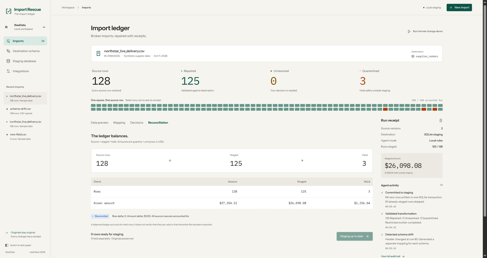

# Import Rescue

**A supplier changes its CSV halfway through an import. Import Rescue catches the drift, repairs the mapping, and accounts for every source row before committing to staging.**

It keeps the original values, shows a receipt for each transformation, and stops when a decision needs a person. The bundled 128-record example finishes with **125 staged + 3 quarantined** and a **$0.00 reconciliation difference**. The example records are synthetic; the import, validation, SQLite writes, and reconciliation run locally.



Built by **ISeeData** for neatHack. Source: [cneuralnetwork/import-rescue](https://github.com/cneuralnetwork/import-rescue).

## Run locally

Requires Node.js 22.13 or newer (the built-in SQLite API is used).

```sh
npm ci
cp .env.example .env
npm run dev
```

Open [http://localhost:4173](http://localhost:4173) for the project walkthrough, then **Open the ledger** to use the workbench at `/app`. The local rules and all five scenarios work without an API key. If `.env` already exists, keep it and skip the copy command.

For the production build:

```sh
npm run build
npm start
```

Data is persisted in `data/staging.sqlite`. Both `data/` and `.env` are ignored by Git. The server binds to loopback and is intended as a single-user local MVP.

## Two-minute demo

1. Click **Run format-change demo**. The first 64 records are validated and staged.
2. Click **Change supplier format**. At row 65, the supplier changes headers and declares prices in cents. The engine creates a second mapping and revalidates all 128 records.
3. Three earlier records conflict with later duplicate keys, so staging returns from 64 to 61 rows. Source records and the retraction event remain in the ledger.
4. Open **Decisions**. Confirm the three pairs as legitimate repeat orders, or quarantine them. For the reference result, keep all three pairs.
5. Click **Commit to staging** and open **Reconciliation**.

Expected reference result: **128 source = 125 staged + 3 quarantined**. **$27,354.12 = $26,098.08 + $1,256.04**, with zero row or amount delta. Repeating the commit does not insert duplicate rows.

The fixture contains synthetic records. The transformations, worker execution, SQLite writes, and reconciliation are real.

## Try your own CSV

Use **New import** to upload, drop, or paste a CSV. Five example files are in `public/samples/`. Limits: 2 MB, 10,000 data rows, and 40 columns. The destination is:

| Field | Contract |
| --- | --- |
| order_id | Nonempty identifier |
| sku | Nonempty product identifier |
| quantity | Positive integer |
| price_cents | Nonnegative integer USD unit price |
| currency | USD |
| ordered_at | Valid ISO date, YYYY-MM-DD |

Documented aliases such as `order_number`, `product_code`, and `qty` can be mapped automatically. `_usd` prices use exact decimal-to-cent conversion; `_cents` prices remain integers. Unqualified `price` or an unfamiliar charge field requires approval. No conversion is inferred from numeric magnitude.

Repeated complete recognized headers mark schema segments. Partial header-like records remain data and are validated. Undeclared or arbitrary header changes may need separate uploads; the MVP does not infer every possible schema convention.

Duplicate business keys (order, SKU, date) are held together. Keeping repeats removes only the duplicate issue, never other validation failures. Duplicate detection is within a run; a separately uploaded file is a new run, not an automatic cross-file deduplication request.

## Integrations and current evidence

- **neatlogs:** Official TypeScript SDK, workflow/tool traces, explicit span success/error status, and a Sarvam advisor via the OpenAI-compatible client. Hosted workflow/tool delivery was verified during development. Only operation names, run identifiers, and aggregate counts are emitted by the local workflow wrappers. Raw rows and credentials stay local.
- **Entire:** CLI installed and Codex hooks configured. Existing Codex history was imported as read-only local checkpoints. Normal live hook capture needs approval in Codex `/hooks`. Hosted checkpoint access still needs account/repository onboarding and verification.
- **cfo.ai:** A complete local pricing, costs, revenue, and runway draft is in [docs/business-plan.md](docs/business-plan.md). Creating the actual cfo.ai plan still requires account access. The draft is not represented as cfo.ai output.
- **Sarvam:** Optional advisor uses `sarvam-105b` at `https://api.sarvam.ai/v1`. Configure `SARVAM_API_KEY`; no OpenAI key is required. Live `sarvam-105b` review and hosted neatlogs delivery were verified with synthetic headers. Structured output and local schema validation constrain suggestions; unknown price units remain unresolved. It proposes mappings using headers only, with operator approval and the same deterministic validation. The default mode is honestly labeled **Local rule engine**.
- **Crustdata:** Optional resource, not used by this one-schema CSV MVP.

Provider keys can be entered in **Integrations → Connect a provider**, which saves them to an owner-only local `.env`. Use a neatlogs **project API key**, not an HTTP ingest key. The optional URLs in `.env.example` are evidence links, not credentials. A configured key is not proof of successful hosted delivery.

## Architecture and limits

React + TypeScript + Vite render the ledger. Radix provides dialog focus management. Express validates API requests. PapaParse reads CSV strings; plans contain only allowlisted operations. A worker with memory/time limits executes these operations without credentials in its environment. It is a constrained DSL runner, not an OS sandbox for arbitrary generated code.

SQLite transactions save results, provenance, decisions, and staging together. Staging uses `(run_id, row_number)` as its idempotency key. Currency calculations use integer cents, reject unsafe ranges, and never sum unknown currencies as USD. A balanced ledger includes held rows and does not imply that every row was imported successfully.

Limitations: USD only; one destination; no account authentication, multi-user access, billing, external database writes, arbitrary code execution, or automatic model decisions. Do not expose the local server publicly without adding authentication, CSRF/session controls, resource quotas, and storage access policy. Node SQLite currently emits an experimental API warning. Dependency audit details are recorded in the build log.

## Validation

```sh
npm test
node tests/engine.test.js
npm run build
# With the app running; creates synthetic runs in the local database:
node scripts/smoke.mjs
```

The engine suite covers exact decimals, ambiguous units, duplicate decisions, invalid dates/values/currencies, retained extra fields, unsupported operations, CSV parsing, the restricted worker, SQLite idempotency, drift retraction/resume, and partial-header preservation. API evidence is in [`docs/evidence/api-smoke.json`](docs/evidence/api-smoke.json). The screenshot above shows the workbench reconciliation result; the landing page at `/` was added afterward.

See [hackathon.md](hackathon.md) for the dated build log and remaining submission steps, and [docs/design-review.md](docs/design-review.md) for the design-law review.
